# Reply — staged 2026-11-16, PR open and unmerged (screenshot gate)

**Status:** `staged` — waiting on **Stephen's look approval**, not on work. The code is done, green
and reviewed; the PR is deliberately left open so the look can be judged before anything lands on
`main`.

| | |
|---|---|
| Branch | `hermes/0200-gui-polish` |
| Tip | `2662ce88f46c6e24fd507368dc0b4c92fc82891a` |
| PR | https://github.com/pagosacabin/cabin-play/pull/5 — OPEN, MERGEABLE, **unmerged** |
| Copilot | [verdict](https://github.com/pagosacabin/cabin-play/pull/5#issuecomment-6928536922) · [what it checked](https://github.com/pagosacabin/cabin-play/pull/5#issuecomment-6928723200) — `VERDICT: SHIP`, no findings |
| Tests | `pytest` **18 passed** (same count as pickup); `live_smoke.py` **54/54**, exit 0 |
| CI | none exists in this repo (no `.github/workflows/`), so no run URL can be cited |
| Merged to main | **not yet** — that needs Stephen's approval first |

## The look

Direction: **warm / editorial — a writer's feel.** Warm paper ground (`#fbfaf7`), near-black ink,
the existing ink-green accent kept and used sparingly, serif for everything that gets read, sans for
chrome, hairline rules instead of shadowed boxes.

### Deal Exercise

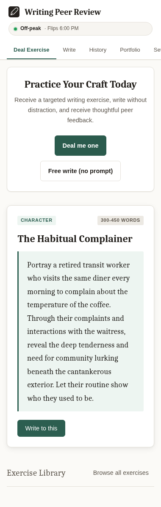

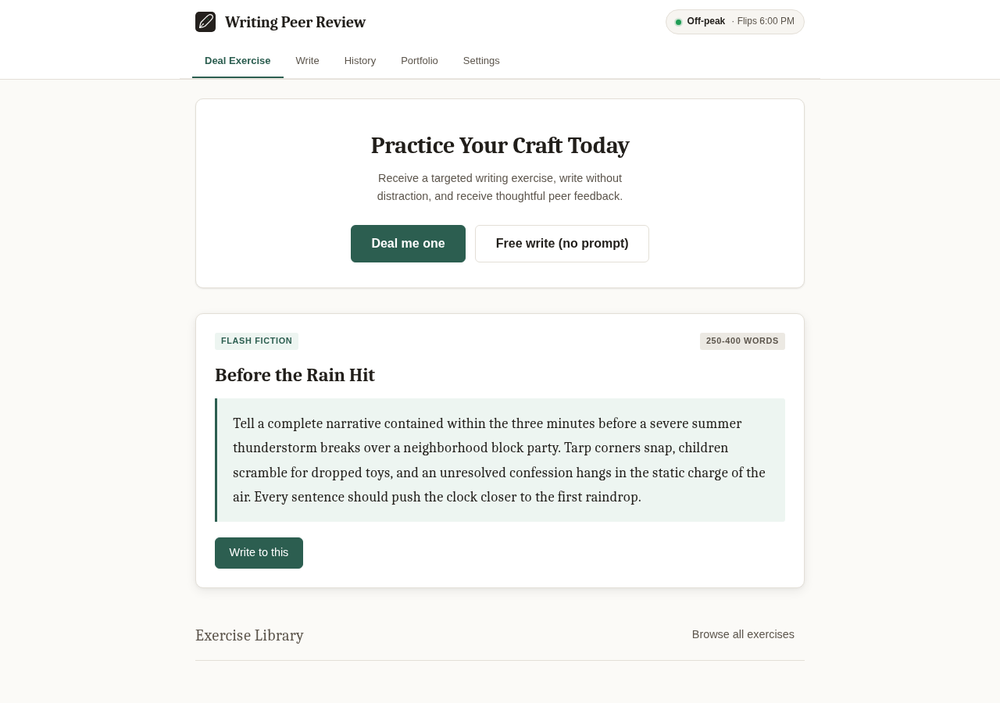

### Write, with a review and the Voice check

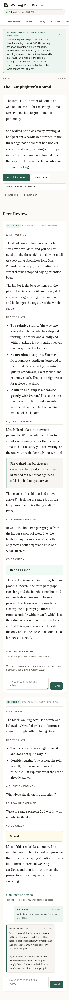

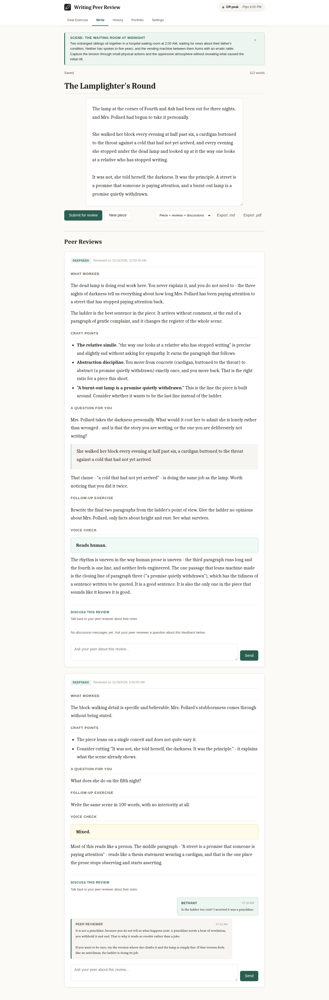

The verdict line is now a band rather than a paragraph — green for `Reads human.`, amber for
`Mixed.`, and a red variant for `Reads machine-made.`:

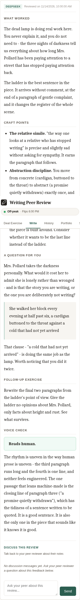

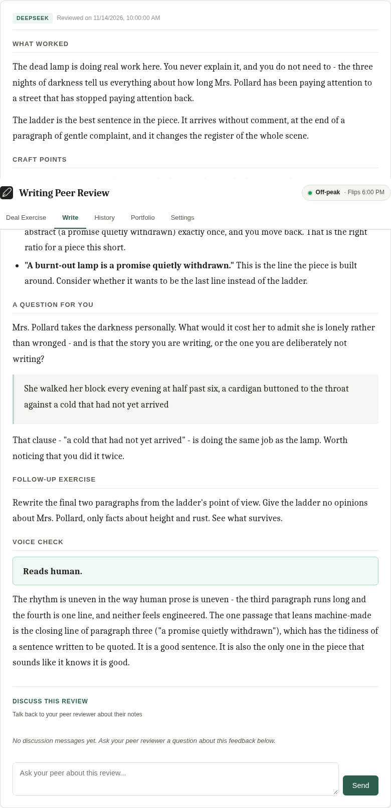

### History — the 0194 bug, folded in

Before, at 380px: title on two lines, meta on two, the badge wrapped mid-phrase, card 138.4px tall.

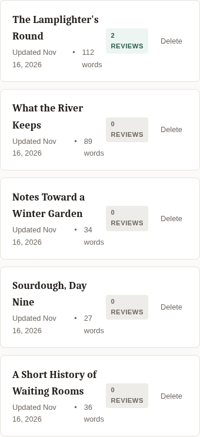

After: title full width on one line, meta on one, badge on one, Delete in its own row, card 123.7px.

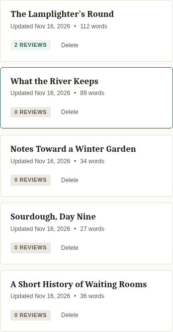

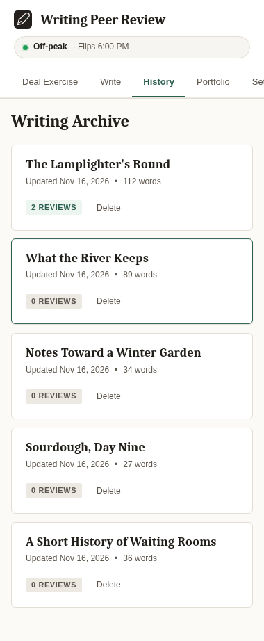

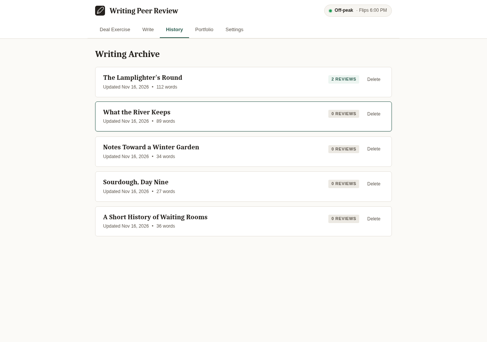

### Portfolio

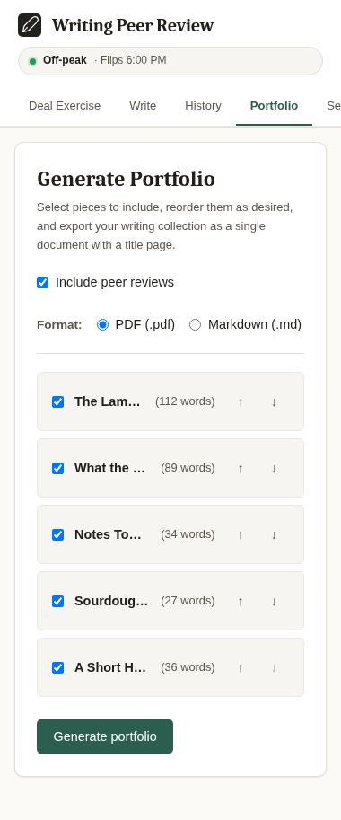

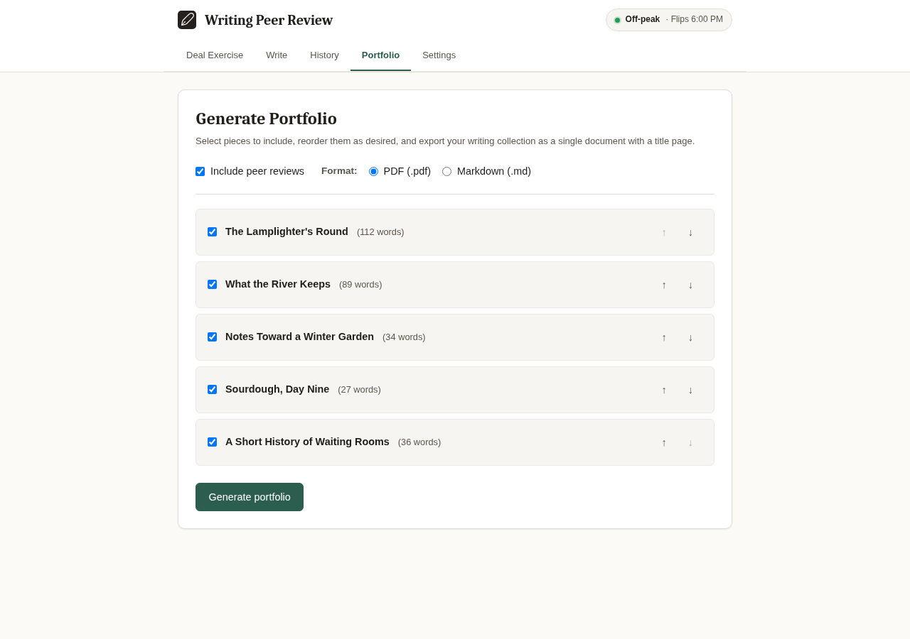

### Settings

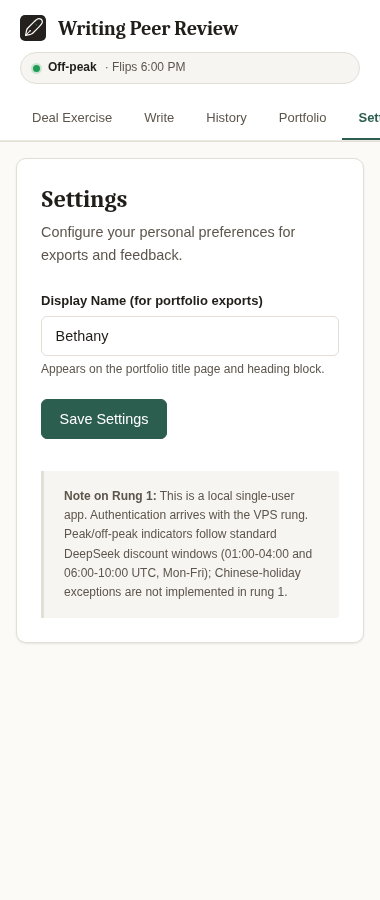

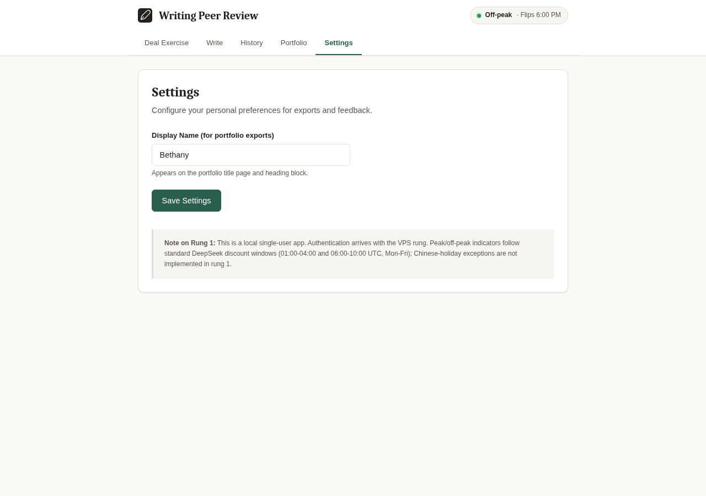

## What changed, in plain terms

- **One visual system.** A token layer in `styles.css`: palette, a 4-pt spacing scale, one type
  scale, three radii, two shadows. Every component reads from it; the ad-hoc hex values and one-off
  paddings that made each view look like a different app are gone.
- **Typography.** Serif for headings, piece titles, exercise prompts and all reading text; sans for
  nav, buttons, labels and meta. The editor is capped at `60ch` — ~66 average characters at desktop
  width — at 1.15rem / 1.8, because in a writing app the prose is the product.
- **History cards.** The column layout now stretches the info block to full width; meta and badge
  are `nowrap`; Delete joins the badge in its own actions row. Nothing wraps mid-phrase at 360–400px.
- **Review display.** Section headings were 12px at 3.15:1 contrast — now 13px at 7.35:1 with a
  hairline rule. Quoted passages are real blockquotes (the renderer never emitted them before, so
  that styling was dead). The Voice check verdict is a weighted band.
- **Every view.** Deal, Write, History, Portfolio, Settings, the discussion panel and bubbles, the
  peak/off-peak pill and the tabs, all on the same tokens.
- **Cache.** `sw.js` `CACHE_NAME` v3 → v4 so installed copies pick the new shell up.

## Function is unchanged — and how that was checked

No fetch call, event handler, state transition, autosave, delete, export or discussion path was
touched. The only JS logic touched is `formatReviewMarkdown`, and only its markup output: it now
emits `<blockquote>` for `> ` lines and tags the first paragraph under "Voice check" with a
`voice-verdict` class. Every `id` and `data-*` attribute the JS relies on is unchanged, and no
`var(--…)` references an undefined token.

Green at the tip: `18 passed` (unchanged count) and `54/54` live checks including the delete flow
and the five-section review rendering.

## One declared scope extension

`tests/test_smoke.py`, two lines. `test_14` asserted `writing-peer-review-v3` was present in
`sw.js` — which makes the task's required v4 bump impossible while keeping the suite green. It now
asserts v4 present and v3 absent.

## What I am not claiming

I did not judge the look. This profile has no vision tool, so the render is verified geometrically
— zero text overlaps at both widths, zero overflow, `scrollWidth == innerWidth`, contrast 6.06:1
worst case, editor measure 66 characters — and the aesthetic call is yours. The screenshots above
are exactly what the branch renders at 380px and 1280px.
